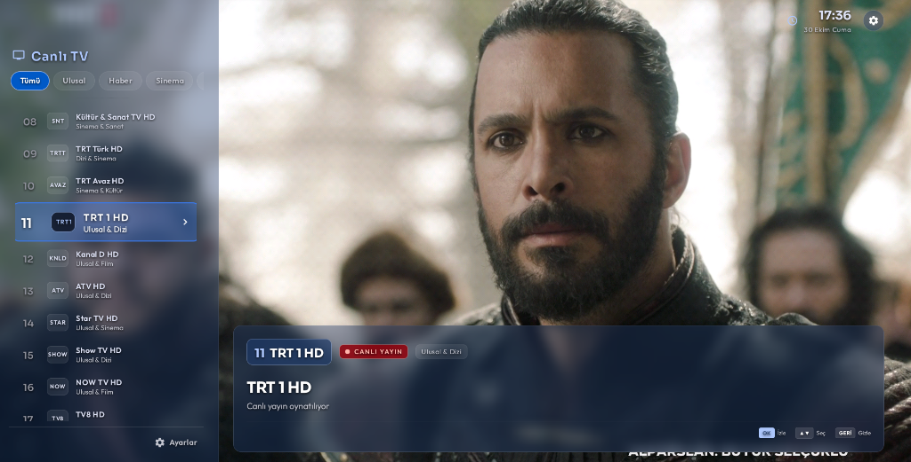

# MiBox IPTV 📺

Xiaomi Mi Box ve tüm Android TV cihazları için optimize edilmiş, minimalist ve modern cam (glassmorphism) tasarımlı canlı televizyon izleme uygulaması.

---

## 📸 Ekran Görüntüleri

| Canlı TV & Kanal Listesi | Ayarlar & Güvenlik Menüsü |
| :---: | :---: |
|  |  |

---

## ✨ Özellikler

- **Android TV & Kumanda Odaklı:** Tamamen D-Pad (kumanda yön ve OK tuşları) ile rahat kullanım.
- **AndroidX Media3 (ExoPlayer):** Düşük gecikmeli, donanım hızlandırmalı (Hardware Codec) akıcı HLS (`.m3u8`) oynatma.
- **Minimalist Cam Tasarımı (Glassmorphism):** Canlı yayını engellemeyen yarı şeffaf sol menü ve sağ alt HUD bilgi göstergesi.
- **Kanal Düzenleme (Sıralama):** Kanalları kumandayla tutup istenilen sıraya taşıyabilme. Sıralama kalıcı olarak saklanır ve kanal numaraları (`01..N`) otomatik güncellenir.
- **Kanal Silme & Hafıza:** İstenmeyen kanalları listeden gizleyebilme/silme. Silinen kanallar hafızada güvenle tutulur.
- **PIN Şifre Korumalı Sıfırlama:** Silinen kanalları geri yükleme veya tüm listeyi fabrika ayarlarına sıfırlama işlemleri için 4 haneli PIN şifresi tanımlayabilme.
- **⚙ Ayarlar Sekmesi:**
  - Kumanda kanal değiştirme yönünü belirleme (Yukarı: Sonraki Kanal / Aşağı: Önceki Kanal veya tersi).
  - Silinen kanalları görüntüleme ve tek tıkla geri getirme.
  - Şifre atama, değiştirme veya kaldırma.
- **Android 9+ SSL Uyumluluğu:** Eski Android TV cihazlarında modern HTTPS akışlarının sorunsuz çalışması için gömülü kök sertifika desteği.

---

## 🛠 Kullanılan Teknolojiler

- **Dil:** Kotlin
- **Platform:** Android TV (Minimum SDK: 28 / Android 9.0)
- **Oynatıcı:** AndroidX Media3 (ExoPlayer HLS)
- **Ağ:** OkHttp
- **Asenkron Yapı:** Kotlin Coroutines & Flow
- **Arayüz:** ViewBinding, Custom Glass Drawables, RecyclerView

---

## 🚀 Derleme ve Kurulum

Projeyi bilgisayarınızda derleyip cihazınıza yüklemek için:

1. **Projeyi klonlayın:**
   ```bash
   git clone https://github.com/msozturktr/mibox-iptv.git
   cd mibox-iptv
   ```

2. **APK'yı derleyin:**
   ```bash
   ./gradlew assembleDebug
   ```

3. **ADB ile Mi Box / Android TV'ye yükleyin:**
   ```bash
   adb connect <CIHAZ_IP_ADRESI>:5555
   adb install -r app/build/outputs/apk/debug/app-debug.apk
   ```

---

## 🎮 Kumanda Kısayolları

| Tuş | İşlev |
| :--- | :--- |
| **OK / Enter** | Kanal listesini açar / Seçili kanalı oynatır |
| **▲ / ▼ (Yukarı / Aşağı)** | Kanal listesinde gezinir (veya tam ekranda kanal değiştirir) |
| **▶ (Sağ)** | Kanal listesini gizler |
| **Geri (Back)** | Menüden / modlardan çıkar veya listeyi kapatır |
| **0 - 9 (Varsa)** | PIN giriş ekranında doğrudan şifre yazma |

---

## 📄 Lisans

Bu proje kişisel kullanım amacıyla geliştirilmiştir. Yayın akışları ilgili yayıncıların kamuya açık kaynaklarından sağlanmaktadır.
